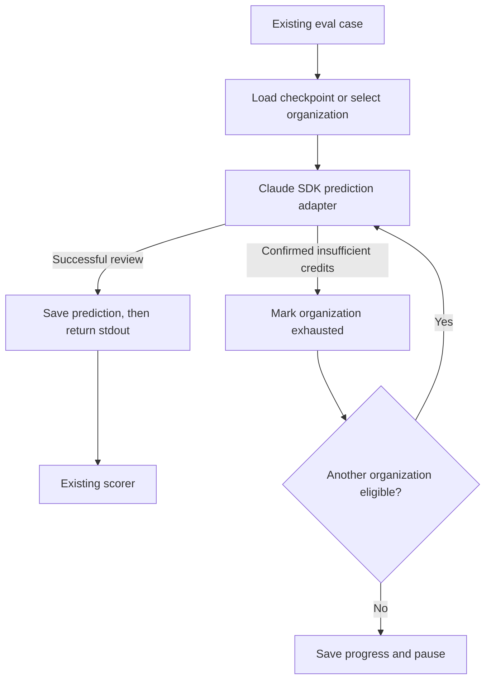

# Sequential Claude Credit Evals

Approved for implementation on 2026-10-24. Run the existing skill-review evals against Claude, consuming one organization's available credits before automatically trying the next organization.

## 1. Objective

Use the separate $200 monthly Claude API allocations to run automated evaluations in this repository without manually switching organizations. A single queue uses an ordered set of API keys, advances on confirmed insufficient credits, preserves completed predictions, and pauses cleanly when every organization is unavailable. The user has confirmed that none of the organizations will hold purchased credits. Auto-reload must also remain disabled; no estimated dollar cutoff is needed to select the next organization.

## 2. Scope & Non-goals

### In scope

- Evaluate only `kramme:skill:review`, using its existing train/validation/test fixtures and scorer. This stays inside the accepted [skill quality regime](kramme-cc-workflow/docs/decisions/2026-07-06-skill-quality-regime.md).
- Add an opt-in Claude Agent SDK prediction adapter behind the runner's existing `--prediction-command` interface.
- Add sequential organization selection, restart of an unfinished read-only case after credit exhaustion, persistent progress, bounded retries, and per-attempt evidence.
- Support local execution and a separate scheduled/manual GitHub Actions workflow. Existing fixture-only tests and CI remain credential-free.
- Finish the requested finite set of eval cases even when credits remain. Exhaustion controls routing; it does not create an endless workload to burn unused credits.

### Implementation components and dependencies

All new runtime files below live in `kramme-cc-workflow/evals/skill-review/`; no additional skill-behavior eval directory is introduced. Filenames and options are proposed interfaces for this implementation.

| Component | Responsibility and dependency |
| --- | --- |
| `credit-pool.js` | Validate organization aliases and environment-variable references; select the current key; classify trusted runtime errors; maintain exhaustion/recheck state. Independent of Claude and scoring. |
| `eval-state.js` | Atomic checkpoint writes, one-writer lock, run identity, completed predictions, and sanitized attempt metadata. Used by the adapter and live entry point. |
| `claude-predict.js` | Read adapter-version-1 JSON on stdin, stage reviewer and fixture, run a bounded SDK session with one selected key, handle credit failover, and emit only the completed review on stdout. |
| `claude-profile.js` | Stage isolated reviewer/fixture files and define the read-only tool, environment, and skill-name policy used by the prediction adapter. |
| `run-live-eval.js` | Validate live configuration, create/resume a run, invoke the existing `run-eval.js` with the adapter, and publish complete/paused/error results. Reuse existing scoring instead of creating a second scoring loop. |
| `credit-pool.example.json` | Credential-free example containing ordered aliases and key environment-variable names. No balances or account login data. |
| `.github/workflows/skill-review-live-eval.yml` | Serialize scheduled/manual runs, inject secrets, restore/save checkpoints, and upload results. Depends on the tested local entry point. |

Pin `@anthropic-ai/claude-agent-sdk` as a root development dependency with its lockfile. Keep it out of the plugin installer runtime dependencies. Confirm its Node requirement, ESM import boundary, plugin invocation syntax, and error event shapes before implementing the adapter; preserve the converter's existing runtime/module contract. Add `.mjs` lint coverage or a narrow module boundary if the pinned SDK requires it.

### Configuration and operation

- Configure one distinct organization per entry, in desired consumption order: `org-a` / `ANTHROPIC_EVAL_KEY_A`, `org-b` / `ANTHROPIC_EVAL_KEY_B`, and so on. Missing/duplicate aliases, duplicate credential values, empty keys, and malformed configuration fail before a request.
- Require an explicit model identifier through `--model` or `ANTHROPIC_EVAL_MODEL`; record the requested and resolved model. No automatic fallback to another model or subscription login.
- Proposed invocation from the plugin directory: `node evals/skill-review/run-live-eval.js --organizations <config.json> --model <model-id> --split all`. An optional `--run-id` resumes a named local run; `--dry-run` validates configuration and lists work without contacting Claude.
- Proposed defaults: one case at a time; one full sweep daily at 07:23 UTC; one repetition per case; 120 seconds and 12 turns per SDK attempt; a 10-minute ceiling across all attempts for one case; a 30-minute workflow ceiling. Respect the finite case/workflow ceilings even when many keys are configured.
- The live entry point adjusts `SKILL_REVIEW_EVAL_PREDICTION_TIMEOUT_MS` above its own per-case deadline so cancellation and checkpoint writes happen before the existing runner kills the process group. Keep the existing runner's fixture-mode timeout default unchanged.

### Non-goals

No credit transfers, purchased credits, automatic purchases, balance scraping, Admin API credentials, provider proxy, distributed workers, batch processing, SkillOpt training, new eval targets, scorer redesign, skill edits, or automatic application of generated changes. Cross-organization continuation of a partial SDK session is out of scope; restart that read-only case instead.

## 3. Boundaries

### Always Do

**Keep the adapter contract narrow.** `run-eval.js` already sends item context without expectations and scores stdout. Preserve that schema and the scorer. Resolve the configured reviewer skill, stage its exact content/resources as a minimal local plugin, and explicitly invoke it against the fixture. Require trace evidence that the requested skill was actually invoked before accepting a prediction. Collect only the final successful result; an error event or partial response is not prediction text.

**Separate keys and answer data from the agent.** Give the SDK child only the selected key and explicitly allowed runtime variables; remove the other keys, pool configuration, GitHub token, inherited subscription credentials, user settings, and unrelated MCP/plugin configuration. Place only the selected reviewer, necessary resources, and selected fixture in its working area. Do not copy item expectation JSON, saved fixture answers, checkpoints, reports, or the full repository. Enforce real-path read boundaries with a pre-tool hook, including symlink traversal. Expose only skill invocation and bounded file-reading tools; deny shell execution, writes, network tools, delegation, and unrecognized tools. A bare SDK `allowedTools` list alone is not an isolation boundary. Document the static scanner as unavailable in this controlled profile, rather than changing the skill or allowing arbitrary shell commands.

**Switch only on exhaustion evidence from the runtime.** Implement the following table against the pinned SDK's structured events/exceptions and the API payload it exposes. Never classify a model-authored sentence or fixture text as a billing error.

| Observed outcome | Action |
| --- | --- |
| Confirmed insufficient credit balance | Record exhaustion, close the old session, discard its partial prediction, and restart the same case with the next eligible organization's key. Record any earlier usage. |
| Ordinary rate limit, overload, or retryable network failure | Honor retry timing and bounded SDK retries on the same key. Do not mark it exhausted or rotate keys to avoid throttling. If retries end, stop with resumable error status. |
| Explicit organization/workspace spend cap | Report a configuration/limit error. It is not proof that the promotional balance is empty. |
| Invalid/revoked key, permission failure, malformed request, unsupported model, ambiguous billing error | Stop with a sanitized diagnostic naming the organization alias; do not silently treat it as exhausted. |
| Turn/deadline limit, interruption, or missing final result | Save incomplete attempt metadata, retain prior completed cases, and stop resumably. Do not score partial text. |
| All configured organizations exhausted | Save `PAUSED_NO_CREDITS`, including pending cases and next recheck time; return without a complete aggregate score. |

Anthropic documents both billing errors and other 400/429 failures, so a status code alone cannot establish credit exhaustion. A narrowly recognized insufficient-balance payload is required; unknown shapes fail closed. See [API errors](https://platform.claude.com/docs/en/api/errors) and [monthly credit behavior](https://support.claude.com/en/articles/17154008-monthly-api-credits-for-max-and-team-plans).

**Persist progress before reporting success.** Use `.context/claude-evals/pool-state.json` for organization state and `.context/claude-evals/runs/<run-id>/` for the run manifest, completed predictions, sanitized attempt traces, and report. Use schema versions, temporary-file-plus-rename writes, restrictive local file permissions, and a lock that rejects a second writer. Validate state on load; an incompatible/corrupt checkpoint stops with a recovery diagnostic rather than silently spending on a fresh run. Confirm `.context/` is ignored in every clone; add an explicit ignore entry if necessary.

- Pool state stores aliases, active organization, exhaustion timestamps, and `recheck_after`, never key values. Bind an entry to a nonreversible credential fingerprint so intentional key replacement invalidates only that entry's stale exhaustion state.
- Retry an exhausted organization at most once per 24 hours using the next pending real case, with immediate fallback if it is still empty. This accommodates different billing anniversaries without guessing a shared reset date or making balance-probe requests. A due earlier organization may be tried between cases; do not interrupt an active session.
- A run manifest freezes its case list and a fingerprint of reviewer/resources, fixtures, scoring expectations/scorer version, adapter/profile, SDK version, requested model, and repetition. Reuse completed predictions only within that run and fingerprint. Keep all answer hashes and scoring data outside the SDK child. Record commit SHA as provenance.
- Resume pending cases before starting another run. A completed scheduled sweep does not become a permanent prediction cache: a later schedule creates a fresh run to measure model behavior again. If current inputs differ from an unfinished run, retain its history and start a new run without mixing predictions across versions.
- Persist a completed prediction before printing it to stdout. A restarted outer runner can replay that saved prediction for scoring without calling Claude again. A crash after a provider response but before the local write can still cause one repeated attempt; exactly-once billing is not promised.

**Keep scheduled work recoverable.** Use a dedicated GitHub Actions concurrency group with `cancel-in-progress: false`, plus the local writer lock. Enable only `schedule` and `workflow_dispatch`; require the trusted `main` branch for both workflow code and checkout. Keep the existing PR workflow credential-free.

- Use `contents: read` and `actions: read`; grant no repository write permissions. Inject organization keys only into the live runner step.
- Restore validated checkpoint artifacts from this same workflow's latest trusted default-branch run containing one, including paused/failed runs. Do not accept state from PR runs or arbitrary artifacts. First use or artifact expiry starts fresh with an explicit notice; malformed existing state is an error.
- Upload checkpoint/report artifacts in an `always()` step, using 90-day retention when repository policy allows. Stage an explicit allowlist of files outside hidden directories for upload, since `.context/` is hidden. Exclude secret configuration, SDK auth files, and environment dumps. Retire local checkpoints when their run is deliberately discarded; CI retention removes old evidence.
- Distinguish `COMPLETE` with passing scores, `COMPLETE` with failed checks, `PAUSED_NO_CREDITS`, and infrastructure/configuration `ERROR`. Proposed CLI exits: 0 for complete/pass, 1 for error or completed check failures, 2 for credit pause. CI may handle exit 2 as an expected pause, but its summary must say evaluation is incomplete. Show completed/total cases, scores only where available, organization switches, usage estimates, and pending work. Never turn missing cases into a passing full-suite score.
- Hard cancellation or runner loss can prevent the final artifact upload. Resume from the last durable artifact and disclose that intervening read-only cases might repeat. This tradeoff avoids introducing an external state service.

**Document the limits of the result.** The existing scorer matches normalized phrases; preserve it initially and report its diagnostics. Live results are observational, outside required PR gates. Keep test items held out from prompt tuning and SkillOpt selection. SDK cost estimates support analysis, not key rotation or authoritative billing. Setup and usage belong in the root README, with technical details in the eval README and development/code-map documentation. Record the local-only eval-host surface in the portability matrix. No shipped skill/agent/hook changes are planned, so component regeneration and skill security scans are needed only if implementation later changes those sources.

### Ask First

- The live-eval entry point is a new maintainer interface: its proposed CLI/configuration, statuses, and checkpoint formats are included in this draft for review. Revisit material interface changes with the maintainer rather than changing the existing runner's version-1 contract.
- Expanding to other skills, editing generated candidates, buying credits, or enabling paid fallbacks would widen the agreed scope. Broader committed skill-behavior evals also require revisiting the existing ADR.

### Never Do

- Treat every 400, 402, or 429 as an empty balance, or silently fall back to a subscription or another provider.
- Expose the answer key to Claude, score a partial failed attempt, conceal an organization switch, or discard prior completed results when credits run out.
- Put API keys in committed configuration, command arguments, prompts, stdout, traces, or uploaded checkpoints; change installed skill copies or production skills during an eval.

## 4. Testing Strategy

| Tier | Coverage |
| --- | --- |
| Unit | Organization ordering; exact exhaustion recognition versus generic billing/cap/rate-limit errors; UTC recheck timing; changed credentials; all-empty pause; bounded retries; state/schema validation; fingerprints; no stale prediction reuse. Use fake clocks and SDK events. |
| Integration | Existing stdin/stdout adapter protocol with a fake SDK; A succeeds then exhausts, unfinished case restarts on B, later work stays on B; all-empty pause and refreshed A recovery; interruption/restart preserves completed predictions; errors never become review text; scorer failures propagate distinctly from a pause. |
| Isolation and CI contracts | Child sees only its selected credential; fixture attempts cannot read expectations, checkpoints, parent paths, or symlink escapes; shell/writes/delegation denied; actual skill invocation required; restored artifact provenance and expiry; secret-free artifact allowlist; default-branch/event guards; lock rejects overlap. |
| Live acceptance | One explicitly requested manual SDK run against the existing fixtures after configuration. Verify model/skill identity, trace, score diagnostics, and organization attribution. Test exhaustion with injected SDK failures; never intentionally consume $200 merely to validate switching. |

Proposed focused suites: `tests/node/credit-pool.test.js`, `tests/node/eval-state.test.js`, `tests/node/claude-predict.test.js`, and `tests/skill-review-live-eval.bats`. Extend `tests/skill-review-eval.bats` only for preserved/new entry-point contracts. Register new JS production sources in `config/coverage-production-sources.json` and include them in JS linting.

Run each closest focused suite first, then `make -C kramme-cc-workflow test-skill-review-eval`, `make -C kramme-cc-workflow skill-eval-skill-review`, and `make -C kramme-cc-workflow test-smoke`. Finish with `make -C kramme-cc-workflow pr-verify` for the SDK dependency, CI, and runtime additions. Every default check remains offline and must pass without API credentials. The live smoke is separate and reports its actual outcome.

## 5. Open Questions

- No blocking product questions remain: sequential exhaustion, automatic failover, no purchased balance, and preserved progress are agreed. Schedule/limits above are proposed configurable defaults.
- Setup inputs: the actual organization aliases, secret names, and explicit model identifier must be configured before the first live run. Organization count is data, not a code constant. Keep auto-reload disabled in each organization.
- Verified during implementation against a loopback-only API with SDK 0.3.310: insufficient credits produce an outer `billing_error` assistant event, `api_error_status: 400`, and synthetic text `Credit balance is too low`. The SDK throws after the error result; retain the observed category. A generic 402 billing error still stops rather than rotating. Tests pin this contract without real credit consumption.
- POTENTIAL CONCERNS: monthly credits refresh on each subscription's billing anniversary, while spend caps reset on the calendar month. An exhausted entry becomes eligible after 24 hours, and the next scheduled run performs the recheck; the daily schedule can add another interval before refreshed credits are reused. Unrelated spend-cap errors need a configuration fix. [Anthropic documents the different cycles](https://platform.claude.com/docs/en/about-claude/api-credits-for-subscribers).
- POTENTIAL CONCERNS: model/tool permissions and scanner availability are intentionally controlled. This tests skill invocation and fixture review under the recorded eval profile, not every interactive Claude Code feature. The phrase scorer can penalize a correct paraphrase; inspect the baseline before treating its score as a broad quality claim.

## 6. Success Criteria

- [ ] One invocation consumes cases through A, then B, then later organizations on confirmed exhaustion, without operator intervention or duplicate completed work in a resumed run.
- [ ] Mid-case exhaustion discards the partial response, closes the old session, starts a fresh session on the next key, and retains attempt evidence.
- [ ] All-empty operation preserves pending work, reports an incomplete pause, and automatically retries exhausted entries after the 24-hour interval without assuming a first-of-month refresh.
- [ ] Completed prediction replay survives process/workflow restarts, respects the run fingerprint, and never suppresses future scheduled sweeps.
- [ ] Only the selected organization's credential reaches each SDK session, the reviewer skill is actually invoked, and the agent cannot read scoring expectations or unrelated files.
- [ ] Rate limits, unknown billing errors, authentication failures, spend caps, and timeouts follow their documented distinct outcomes.
- [ ] The trusted scheduled/manual workflow restores and uploads validated state, publishes clear complete/failed/paused summaries, and prevents overlapping execution.
- [ ] Existing fixture tests, CLI output/contracts, scoring rules, and credential-free PR CI continue to pass; focused new tests and `pr-verify` pass without live credentials.
- [ ] Maintainer setup, recovery behavior, scorer/profile limits, and a separately observed live-smoke result are documented before calling the feature operational.
